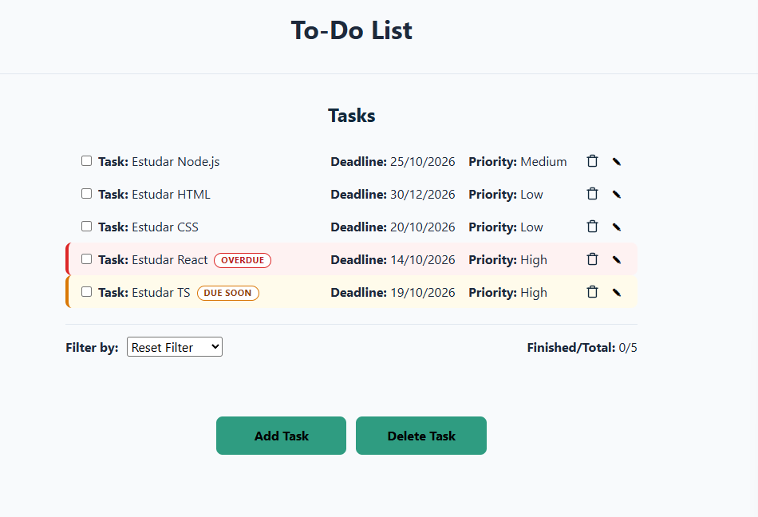

# To-Do List

A responsive, keyboard-friendly to-do list built with **vanilla HTML, CSS and JavaScript** — no frameworks or libraries. Tasks are saved in the browser, so they are still there when you come back.

🔗 **Live demo:** [https://luismafra1.github.io/to-do-list-project/](https://luismafra1.github.io/to-do-list-project/)
🔗 **Repository:** [github.com/luismafra1/to-do-list-project](https://github.com/luismafra1/to-do-list-project)


## Features

- **Add, edit and delete tasks**, each with a name, a deadline and a priority (high, medium or low)
- **Mark tasks as finished**, with a strikethrough style that is kept after reloading the page
- **Finished/Total counter** that updates on every change
- **Sort and filter** by task name, deadline, priority, finished or not finished
- **Persistent data** using `localStorage`
- **Delete several tasks at once** by selecting them first
- **Confirmation dialog** (native `<dialog>`) before discarding unsaved changes
- **Validation**: a task cannot be saved without a name
- **Dates in the Brazilian format** (DD/MM/YYYY)
- **Responsive layout** that switches from a column-aligned grid to a stacked layout on small screens
- **Deadline alerts**: unfinished tasks are highlighted in red with an "Overdue" label when the date has passed, and in amber with a "Due soon" label when it is less than 3 days away

## Accessibility

- Every icon-only control has an `aria-label` that includes the task name
- Task list and counter use `aria-live` so screen readers announce changes
- Editing is done through a real `<button>`, reachable with the keyboard
- Visible focus indicator on the (visually hidden) delete checkbox
- Deadline alerts use a text label as well as color

## Built with

- HTML5
- CSS3 (custom properties, Grid, Flexbox, media queries)
- JavaScript (ES6+, `localStorage`, `crypto.randomUUID()`)

## Running locally

```bash
git clone https://github.com/luismafra1/to-do-list-project
cd to-do-list-project
```

The script is loaded as an ES module (`type="module"`), and browsers block modules when a page is opened directly from the file system. Serve the folder with any local server instead, for example:

```bash
npx serve
# or
python -m http.server
```

The VS Code **Live Server** extension also works.

## Project structure

```
├── index.html
├── css/
│   ├── reset.css
│   ├── variables.css   # design tokens, reusable across projects
│   ├── footer.css      # reusable footer
│   └── style.css       # styles specific to this app
└── js/
    └── app.js
├── assets/
│   └── images/
│       └── screenshot.png
```

## Data model

Tasks are stored as an array under the `tasks` key in `localStorage`:

```json
{
  "id": "b1c2d3e4-...",
  "task": "Study React",
  "deadline": "2026-10-20",
  "priority": "high",
  "isChecked": false
}
```

## What I learned

- **One source of truth.** My first counter and filters read their data from the DOM. Selecting "Finished" and then "Not finished" returned an empty list, because the second filter was working on the already-filtered page. I refactored so the `savedTasks` array holds the state, `getVisibleTasks()` derives what should be shown, and the DOM is only a reflection of it.
- **Stable unique IDs.** Using the array length as an ID created duplicates after deleting a task. Switching to `crypto.randomUUID()` solved it.
- **Dates without timezone bugs.** `new Date("YYYY-MM-DD")` is parsed as UTC and can show the previous day in Brazil. I format dates by splitting the ISO string and sort by comparing the ISO strings directly.
- **HTML boolean attributes.** `checked="false"` still checks the box, because only the presence of the attribute matters. The attribute has to be rendered conditionally.
- **Escaping user input.** Task names are inserted into HTML templates, so quotes or tags could break the markup. A small `escapeHTML` helper prevents that.
- **Layout that stays aligned.** Columns drifted whenever a task had no deadline or a longer priority label. Defining fixed columns with CSS Grid on the row fixed it, and a breakpoint stacks the content before the task name gets too narrow.
- **Changing saved data.** Switching priority from free text to a select changed the stored values and made old data inconsistent, which taught me to think about migration when a data format changes.
- **Accessible interactions.** I replaced double-click-to-edit with a dedicated edit button, since a double click cannot be triggered from the keyboard.
- **Derive the UI from the data.** My first deadline alert patched CSS classes onto the page after rendering. It left stale highlights when a task was completed and threw errors when a filter hid some tasks. Computing the class inside the render step (`getDeadlineStatus`) fixed all of that, because every re-render is correct by construction. It also reuses the date lesson: today's date is built from the local year, month and day, and compared with the ISO strings.

## Author

Made by Luis · [GitHub](https://github.com/luismafra1) · [LinkedIn](https://www.linkedin.com/in/lu%C3%ADs-felipe-mafra-5bb513121/)
